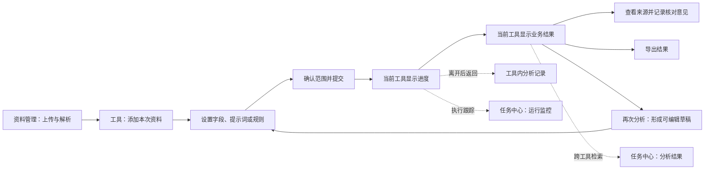

# 模块设计与能力对照

版本：2026-10-25。审查基线：交互原型提交 `2e7b0b2`，静态资源版本 `20261024.80`。本章对照已提供的原 Vue 前端、当前原型实现和既有验证记录；未取得完整后端源码，本章不把前端存在调用等同于线上服务已经可用。

## 1. 审查结论与能力边界

当前产品已形成“添加资料 → 设置分析内容 → 在当前工具查看进度与结果 → 核对依据 → 导出 → 必要时再次分析”的完整交互。任务中心承担跨工具查找成果与跟踪运行的补充职责，不再是查看结果的必经入口。统一的是操作习惯、状态含义和核验方式，各工具的业务输入、分析阶段和结果结构仍各自保留。

本次提升主要发生在流程组织、界面表达、批量操作和连续核验。原 Vue 已有附件、提示词、规则、时间轴、议题聚类、分阶段执行、特殊结果表和导出等能力，不能把这些描述为新研发的 AI 算法。当前原型提供可操作演示与请求结构适配，并不证明模型准确率提高、后台吞吐提升或者真实业务已经上线。

| 标记 | 本章使用的含义 | 可以据此确认什么 |
| --- | --- | --- |
| 原码 | 提供的 Vue 或工具函数中可以确认的交互、配置或调用 | 原前端需要保留的功能与数据语义 |
| 原型 | 当前 `dist` 中可确认的界面、状态、演示流程或请求构造 | 可用于产品评审、前端实现与联调样板 |
| 接入 | 必须以真实接口、身份、权限和数据验证的部分 | 尚不能从静态原型推定生产可用 |
| 建议 | 本次 review 提出的后续补充 | 未计入已交付功能 |

**统一结果原则：**文件“解析完成”表示已具备可读取文本；工具“分析完成”表示本次处理已返回；“已核对”表示已记录人工核对，不代表已确认事实或形成审计结论。这三个状态不可合并。未返回结果、未命中线索、资料不足、执行失败也必须分别表达。

## 2. 整体使用路径与页面分工

“再次分析”沿用已执行的资料、附件和配置快照，进入准备页；用户明确提交后才建立新记录，并保留原结果。它不是立即重跑，也不是覆盖历史结果。失败重试与再次分析分开：前者处理同一次任务的失败部分，后者代表新的分析意图。

### 2.1 准备页采用两类布局

| 布局 | 适用工具 | 原因与操作重点 |
| --- | --- | --- |
| 添加资料 / 查看原文 / 设置内容，三栏 | 信息提取、词云分析、主题归纳、时间轴分析、会议纪要分析、风险点分析、待摊费用 | 设置相对集中，原文可帮助理解资料、修改字段或提示词；查看原文是辅助操作，不是提交前必做步骤 |
| 添加业务资料 / 设置比较或检查规则，两栏 | 招投标分析、合同分析、工程项目一致性、两表项目关联度 | 资料有项目、单位或两表角色，规则数量多；让主要面积用于规则与映射，原文按需打开 |

两类布局使用相同的添加、取消、选择范围、提示词编辑、提交确认与结果操作规范。不能为了外观统一，把两表变成普通文件清单，或把招投标项目角色压平。

结果页不再常驻准备资料清单；主要空间用于业务成果，来源通过行内核验、详情或原文视图进入。当前通用原文标题、文件名、原文件/解析文本切换和放大入口合并为紧凑头部，取消“收起原文”。

## 3. 公共模块

### 3.1 资料管理与资料选择

**业务目标：**让审计人员知道资料放在哪里、是否已解析、哪些资料将参与本次分析。

| 原有能力与问题 | 当前设计与提升 | 正式接入与验收重点 |
| --- | --- | --- |
| 公共、机构/组织关联、个人、项目等资料范围；目录、文件、上传、解析、选择、预览 | 统一“当前目录”；文件上传入口只保留一个，弹窗内选择文件或文件夹；文件夹预筛同时展示类型、数量、名称与相对路径 | 空间与目录权限从服务端返回；项目空间路径显示规则与实际层级一致；文件夹上传保留层级且不误覆盖同名文件 |
| 文档状态与工具任务状态容易混淆 | 资料列表明确“解析完成 / 未解析 / 解析中 / 解析失败”；数字强调，不用“完成 / 待处理”代替 | 后端解析状态映射稳定；正文失败与上传失败分开 |
| 大批量文件分页、跨目录选择 | 表头只选择当前页；独立的“选择全部页”操作明确当前筛选范围；选择数量不随翻页变动 | 服务端分页时不能只持有当前页 ID 冒充全量选择；需确定选择快照、过滤范围及变更行为 |
| 已选资料多处展示导致不清楚谁参与执行 | 资料库选择用于进入工具；工具左栏作为本次执行范围；弹窗选择先暂存、确认后生效 | 搜索、切换目录和显示分页只影响显示，不静默增减本次执行范围 |
| 原件与解析内容需要核验 | 原始 PDF/Word/Excel 与解析文本可对照；长文档按需渲染、保留页码和缩放 | 原件 URL、解析文本、分页位置及权限重新校验；不能以演示文本替代真实原文 |

选择弹窗只允许符合工具要求的资料加入。信息提取等以解析文本为输入的工具，只添加解析完成且有分析权限的文件；不可选择原因应在行内解释，而不是提交后才统一报错。表格工具还要检查文件格式、表头与单/双表角色。

### 3.2 提取模板与提示词库

这两个对象承担不同职责，不应混称“分析方案”。

| 对象 | 业务含义 | 使用方式 | 保留能力与边界 |
| --- | --- | --- | --- |
| 提取模板 | 一组输出字段及每个字段的提取口径 | 信息提取中选模板后调整字段，或直接新增字段；调整后可另存个人模板 | 独立模板页管理分类、字段、复制和配置导出；工具中默认不选模板，避免无意沿用字段 |
| 提示词 | 指导某个分析阶段处理资料的要求，部分工具关联规则或字段配置 | 对应工具进入时默认选择匹配的系统提示词，也允许选择个人保存项 | 分类保留公共（场景/功能/系统）、机构、个人；按工具与阶段过滤，不能把其他阶段配置一起替换 |
| 本次执行配置 | 资料、附件、字段、提示词正文与规则的执行快照 | 任务信息中只读查看；再次分析形成独立可编辑草稿 | 不能跟随提示词库后来修改而改变历史任务 |

当前提示词编辑弹窗把主要空间给正文，辅助说明压缩，保存个人提示词与恢复默认保留。各工具不展示低频的导入/导出设置；**结果导出、词库导入/导出、独立提取模板管理中的配置导出仍保留**。

提供的源码中可见提取模板 API 调用和字段编辑，但本次源码摘录未覆盖一个完整独立模板管理模块。因此，模板分类管理的最终权限、复制语义和服务端 CRUD 应在联调中核实，不宣称“原独立模板管理全部代码已逐行对应”。

### 3.3 任务中心与工具内分析记录

**业务目标：**审计人员找成果，管理人员看执行。两种需求共用任务数据，但不混在同一张高密度技术表里。

| 入口 | 主要内容 | 主要操作 |
| --- | --- | --- |
| 工具内“分析记录” | 只展示当前工具的历史结果与运行状态 | 返回结果、继续未完步骤、处理失败 |
| 任务中心“分析结果” | 各工具成果集合；按工具、名称、状态、日期查找 | **查看结果 / 任务信息 / 导出数据**，三个文字操作直接展示，不加前置图标 |
| 任务中心“运行监控” | 等待、进行中、需关注、失败或停止的执行情况 | 看真实阶段、文件计数、错误与停止/重试入口 |

“查看结果”按工具类型分发到专用业务页面，不能统一跳到通用 JSON 或文件表。“任务信息”承载资料范围、执行配置快照、阶段和失败原因。“导出数据”明确业务产物、范围与格式。

等待、运行或失败时不能假装结果可用；已有阶段结果要明确覆盖范围。没有结果并不等于没有审计问题。合并导出只允许同类工具、兼容结构和有权限的结果，保留来源任务与字段映射；大文件下载链接期限、重试与服务端导出需真实接入。

## 4. 十一项工具的业务设计

### 4.1 信息提取

| 业务环节 | 设计要求与当前落地 |
| --- | --- |
| 输入 | 添加本次待提取资料，支持跨目录与本页/全部页；主文件可关联附件 |
| 设置 | 默认不选提取模板；选取模板或直接编辑字段名称与提取说明；按需合并附件，保留切片与冗余等原有参数 |
| 执行 | 左栏全部已添加资料参与提取；当前预览文件不决定执行范围；提交前列出文件数和字段数 |
| 成果 | 文件 × 字段汇总表，展示取值、未提取项和来源；保留动态字段，不压成固定四列 |
| 核验与复用 | 从字段进入原文核验，可记录独立核对意见；导出当前所需范围；再次分析继承执行字段与附件快照 |

原码依据：`OcrViewer.vue:527` 的附件合并配置、`:539` 的切片参数、`:567` 的模板选择、`:634` 附近字段编辑。原型依据：`extraction-focus.js:21/33/51`、`extraction-attachments.js`、`extraction-workflow.js`、`result-actions.js:24`。

接入重点：字段值须保留真实来源定位和空值语义；附件关系是分析输入，不只是下载列表；多附件来源权限变化要同时约束结果与导出。人工核对意见当前本地保存，协同使用需服务端持久化。

### 4.2 词云分析

| 业务环节 | 设计要求与当前落地 |
| --- | --- |
| 输入 | 一组待了解整体内容的文件 |
| 设置 | 展示词数、停用词、新词；停用词用于排除无关词，新词用于保留特定业务词的完整分词 |
| 执行 | 区分共享词库维护与本次使用词表，形成执行时词表快照 |
| 成果 | 词云与可查找、可排序的词频明细，点击词语查看关联文件与上下文 |
| 核验与复用 | 发现干扰词后加入后续分析的停用词；再次分析明确使用调整后的词表，不静默改历史统计；导出词频及可用的词云产物 |

原码依据：`word-cloud-analysis/Index.vue:39` 的词库弹窗、`:166` 的导入冲突、`:373` 的词频表、`:418` 的 Top N 说明、`:464` 的本次词库选择。原型依据：`word-settings.js`、`word-results.js`、`result-actions.js:33`。

接入重点：词频是内容线索，不是风险程度；共享词库权限及本次选用范围要分开。统计方式、合并频次、来源片段及分词版本应与服务端一致。大规模词库采用分页、检索与冲突处理，避免大量标签堆叠。

### 4.3 主题归纳

| 业务环节 | 设计要求与当前落地 |
| --- | --- |
| 输入 | 一批需要归并业务事项的文本资料 |
| 设置 | 分别设置“资料要点提示词”和“主题归纳提示词”，不把提示词包装成完整方案 |
| 执行 | 保留先提取基础信息、再归纳主题的两阶段逻辑；第二阶段失败时保留第一阶段成果 |
| 成果 | 主题归纳正文/主题视图与逐份基础信息，能从主题追到支撑资料及差异 |
| 核验与复用 | 查看基础信息和来源；仅归纳阶段失败可针对该阶段处理；改变分析意图时再次分析并保留原记录 |

原码依据：`ThemeAnalysisViewer.vue:449–452` 的单任务串联业务类型、`:586–592` 两类提示词、`:1144` 归纳结果。原型依据：`theme-workflow.js`、`prompt-guidance.js:10`、`task-center.js:15`。

接入重点：基础信息与归纳结果必须可关联，不能只保存一篇不可追溯的总结。归纳过程不能把所有相似事项断言为同一事实；缺少资料、差异和不确定内容应保留。

### 4.4 时间轴分析

| 业务环节 | 设计要求与当前落地 |
| --- | --- |
| 输入 | 涉及合同、批复、支付、会议等有时序关系的资料 |
| 设置 | “设置事项提取提示词”，明确提取日期和何种事项 |
| 执行 | 提取事项、日期、来源；没有日期的事项单列，不能补造日期 |
| 成果 | 事项时间线与清单，可按日期、顺序、内容查找 |
| 核验与复用 | 点击事项核对原文，导出事项与来源；修改提取口径后再次分析 |

原码依据：`TimelineAnalysisViewer.vue:99` 的提示词、`:792–799` 的 events 与历史提示词还原、`:443` 的文件与时间轴联动。原型依据：`analysis-workflow.js` 的 `awTimeline()`、`business-flow.js:9`。

接入重点：区分业务发生日期、文件形成日期和模糊时间；事件排序不代表因果关系。当前产品应按实际返回字段展示，日期语义增强属于后续模型/响应契约工作，不应前端凭名称推断。

### 4.5 会议纪要分析

| 业务环节 | 设计要求与当前落地 |
| --- | --- |
| 输入 | 一组会议纪要；单文件可能包含多次会议 |
| 设置 | “设置会议分析提示词”，保留会议与议题提示词、相似度阈值、最小聚类数；后续风险提示词单独设置 |
| 执行 | 先得到会议与议题，再支持风险报告和会议问答；不把后两项伪装为已经自动完成 |
| 成果 | 默认会议时间轴；日期 → 会议 → 议题逐级阅读；议题聚类跨会议追踪，保留议题清单与聚类详情 |
| 筛选 | 人员（含列席）、日期、金额范围、关键词及高级正则；条件同步影响时间轴、聚类、详情与导出 |
| 核验与复用 | 查看议题原文、金额和人员；风险报告及回答保留关联来源；导出会议/议题与阶段成果，必要时再次分析 |

原码依据：`meeting-minutes-analysis/index.vue:457–475` 的聚类与筛选参数、`:512` 的筛选状态、`:633–638` 的风险阶段、`:318` 的结果/筛选/风险 API。原型依据：`meeting-timeline.js:8–17/19–29`、`audit-analysis.js`、`analysis-workflow.js:54/57`。

**必须保留的亮点：**时间轴与议题聚类联动。一个议题可跨多次会议出现，用来追踪讨论、决策和落实；不能为了“简化”退回只有摘要文本或单一表格。当前演示数据用于评审联动和多会议场景，不是生产审计事实。已移除“时间轴演示”独立按钮，但时间轴能力与演示记录仍在。

接入重点：会议 ID 与文件 ID 分开；未知金额不当作 0；金额单位与筛选口径一致；风险报告、聚类版本、问答上下文分别跟踪。导入的旧结果需要结构校验，不能套用当前配置冒充原执行记录。

### 4.6 风险点分析

| 业务环节 | 设计要求与当前落地 |
| --- | --- |
| 输入 | 待检查资料与匹配该业务的风险点集合 |
| 设置 | “设置风险分析内容”：选提示词、勾选风险点，保留按文件/按风险点遍历方式 |
| 大量选择 | 分类导航 + 可检索分页列表 + 已选统计；支持本页/全部匹配范围选择，编辑先暂存后确认 |
| 成果 | 风险检查点、命中线索、资料不足或未命中项；可按风险点或文件定位、筛选和查看依据 |
| 核验与复用 | 从线索进入原文；导出检查结果及来源；再次分析调整风险点或提示词 |

原码依据：`RiskPointAnalysisPrototype.vue:157–184` 的结果搜索与风险路径、`:269–277` 的遍历方式、`:312–334` 的风险树。原型依据：`risk-selection.js`、`audit-analysis.js`、`analysis-workflow.js:46`。

接入重点：风险点 ID、名称、完整层级路径和检查说明一起保留，不以标题代替稳定身份；分页只改变显示，不截断提交的风险点；“未命中”不等于“无风险”。当前千项/万项前端夹具验证不能替代后端真实文件 × 风险点规模的容量测试。

### 4.7 招投标分析

| 业务环节 | 设计要求与当前落地 |
| --- | --- |
| 输入 | 先建立具名项目；每个项目配置招标资料和具名投标单位，各单位分别关联投标文件 |
| 设置 | 选择招标文件、投标文件、招投标联合分析环节；逐环节设置提示词及检查规则 |
| 大量操作 | 项目摘要显示资料数量和缺项；单位展开/折叠、搜索及分页；规则以可检索列表集中维护，详情按需编辑 |
| 执行 | 按选定环节检查资料完整性；联合分析必须在同一项目中具备对应资料，不能跨项目自动拼配 |
| 成果 | 按项目和环节展示检查项、分析说明、文件提取信息及依据，保留证据范围、对比资料和建议 |
| 核验与复用 | 统一核验界面可看完整分析说明与多文件证据，沿当前筛选连续前后核验；导出检查成果；再次分析保留项目与单位角色 |

原码依据：`BiddingAnalysis.vue:35/127` 的项目与单位、`:247–303` 的分析环节与提示词、`:677–686` 的模式资料校验；原结果组件 `BiddingAnalysisResultView.vue`、`BiddingAnalysisEvidenceDialog.vue`、`BiddingAnalysisRuleDetailDrawer.vue`。原型依据：`bidding-materials.js`、`bidding-workflow.js`、`bidding-audit.js:34–38`、`integrated-evidence.js`。

接入重点：招标文件在当前选择器中沿单份替换语义，投标文件允许多份；后端实际字段名可能与中文“招标/投标”直觉不同，应使用既有映射，不能直接把 UI 英文字段名当请求字段。规则结果、证据截断范围、可用与实际使用证据数量都要据实展示。

### 4.8 合同分析

| 业务环节 | 设计要求与当前落地 |
| --- | --- |
| 输入 | 合同及按需关联的补充协议等资料 |
| 设置 | 自动识别或指定合同类别；选择检查规则，编辑检查事项、说明、判断依据、判定标准；保留基础信息提取与合规分析提示词 |
| 大量规则 | 搜索、分页、选用、详情编辑；补充分析与指定规则检查明确区分 |
| 成果 | 合同基础信息与条款检查结果；突出需关注、资料不足等状态，不把无法判断默认为符合 |
| 核验与复用 | 检查内容、分析理由、依据与原文同屏核验，支持连续查看；导出检查表及依据；再次分析保留规则和附件 |

原码依据：`ContractViewer.vue:817–821` 的四项规则完整性、`:960–985` 的自动/指定类别请求分支、`:716–722` 的自动与规则结果合并。原型依据：`contract-workflow.js:17–28/35–42`、`integrated-evidence.js`。

接入重点：自动类别分支和指定规则分支不要混用；原码自动分支不提交与指定类别相同的参数结构。检查结论是核验线索，不代表法律结论或已确认审计发现。结果应保留后端真实字段与无法判定原因。

### 4.9 待摊费用

| 业务环节 | 设计要求与当前落地 |
| --- | --- |
| 输入 | 监理、设计、代建、造价、勘察测绘、招标代理等计费合同 |
| 设置 | 选择费用类型，分别设置提取计费约定和费用计算提示词 |
| 第一阶段 | 提取合同计费约定并显示来源；任务进入“待填计费基数” |
| 第二阶段 | 审计人员核对约定、填写基数，继续同一任务计算；不是另起一次提取 |
| 成果 | 各合同的约定、计费基数、公式/计算过程、费用及未计算原因 |
| 核验与复用 | 对照合同和结算凭证核验；导出约定和费用报告；需调整约定或条件时再次分析 |

原码依据：`PrepaidExpensesPrototype.vue:276` 的两阶段说明、`:1287–1289` 提取入参、`:1421–1435` 续算、`:1536` 基数恢复。原型依据：`prepaid-workflow.js:30/35–46`。

**不能改错的语义：**原参数 `billing_base_wan` 在所提供前端中按“元”输入和提交，不能因为字段后缀自行换算为万元。当前任务级基数用于本次各合同，各合同按各自约定计算；不能默认借用第一份合同的费率。正式上线必须用真实计算报告验证金额、四舍五入和单位。原型中的本地费率与计算仅为操作演示，不是收费依据。

### 4.10 工程项目一致性

| 业务环节 | 设计要求与当前落地 |
| --- | --- |
| 输入 | 一份或多份项目台账，逐份读取实际表头 |
| 设置 | 分别设置重复项目、主子项目两类提示词及字段映射、比较方式、预筛、权重、评分与阈值 |
| 执行 | 各台账内部识别重复和主子项目；配置页签切换不表示只运行当前页签 |
| 成果 | 重复候选、主子候选、两条源记录、动态源字段、字段评分及判定理由 |
| 核验与复用 | 从候选关系对照源行，区分编码规则匹配与模型评分；导出完整候选表；再次分析调整映射和规则 |

原码依据：`EngineeringProjectViewer.vue:145–195` 的两类结果和错误展示、`:567` 的两类请求构造；`engineeringProjectResultMapper.js`。原型依据：`engineering-workflow.js:29/44` 及其映射/结果函数。

**业务命名需补充解释：**当前“工程项目一致性”容易被理解成多文件之间全面一致性核验；实际语义是逐份台账内部查找重复和主子项目。建议在工具描述或成果说明中固定写“识别台账内重复项目与主子项目”，暂不擅改菜单名和接口。

接入重点：逐文件缺列校验；多文件不能混成跨台账比较；动态字段不能截断；24 位编码识别与模型相似分数不同。候选不是已确认重复项目。

### 4.11 两表项目关联度

| 业务环节 | 设计要求与当前落地 |
| --- | --- |
| 输入 | 明确选择表一、表二并设置业务名称；不能把两个相同文件当作两表 |
| 设置 | 对应两侧字段，允许列名不同；设置预筛、评分、权重、完全/部分一致阈值、最少匹配字段、锁定策略和硬规则 |
| 执行 | 保留标准/批量模式，以及每行候选上限和全局上限；只改变配置展示方式，不丢底层参数 |
| 成果 | 完全一致、不完全一致、表一独有、表二独有四区；保留源行、动态列、分数与理由 |
| 核验与复用 | 对照两侧源行，按实际差异核验；二次筛选可恢复；导出当前结果范围的全部页；再次分析调整关联规则 |

原码依据：`AssociationDegreeTwoTables.vue:20/74` 的两表业务名称、`:412` 的表头加载防过期、`:716` 两表校验、`:767–790` 的历史角色/表头恢复；`associationTwoTablesResultMapper.js`。原型依据：`association-workflow.js:24/47`。

接入重点：完全一致为严格大于完全一致阈值，部分一致为大于等于部分一致阈值，沿原规则保留。某行未出现在配对结果中不意味着独有，必须由响应明确返回；候选上限和预筛可能造成未比较记录，不应推断为业务不存在。

## 5. 已经改善了什么，仍不能宣称什么

| 维度 | 可确认的改善 | 不应宣称 |
| --- | --- | --- |
| 操作路径 | 日常任务可在当前工具提交、看进度、看结果、导出；历史从工具内或任务中心返回 | 已减少固定百分比操作时长，除非开展相同任务的用户测试 |
| 新人理解 | 标题采用“添加/查看/设置”等动作；明确本次已选与当前预览的区别；主操作直接展示 | 已证明新人无需培训 |
| 大批量交互 | 文件、单位、风险点、规则和映射采用检索/分页/按需加载，选择不随页码丢失 | 已支持生产万份文件并发或任意规模数据 |
| 业务成果 | 每种工具保留专用结果及来源，会议时间轴/聚类、两阶段费用等特色保留 | AI 提取、风险判断或关联准确率提高 |
| 核验连续性 | 合同/招投标可连续查看分析和证据；提取等可独立记录人工意见 | 已建成完整审计底稿、问题认定、复核审批或协同审签系统 |
| 历史可复用 | 再次分析保留旧结果并形成新草稿；任务信息查看执行快照 | 已具备后端不可篡改留痕或全版本模型追溯 |

## 6. 本次 review 形成的产品缺口与处理建议

| 优先级 | 发现或边界 | 处理建议 | 验收判据 |
| --- | --- | --- | --- |
| P0 | 原型 AI 执行、进度、权限和多数数据由本地演示驱动 | 真实服务联调时逐工具接入，不用模拟成功掩盖接口缺失 | 每工具真实任务从提交、轮询、结果、来源到导出可完整完成，服务失败能如实呈现 |
| P0 | 原型来源可展示，不代表后端每条结果均有稳定位置和结果 ID | 明确结果与证据最小契约，缺位置时显示可核对文件，不伪造页码 | 每条可核验结果至少可追到有权限的来源；页/段/行定位与真实原文一致 |
| P0 | “全部页”现有交互不自动解决后端分页和并发资料变更 | 在接口层确定过滤范围、总量、选择快照及失效反馈 | 切页/搜索不会改变已确认范围，新增/删改资料不会静默混入历史任务 |
| P1 | 人工核对意见是当前浏览器独立存储 | 先做轻量服务端意见保存及稳定结果关联，后续再评估协同复核 | 换设备可恢复且保留核对人/时间/版本；AI 原结果不被覆盖 |
| P1 | 多轮旧说明出现两栏/三栏、旧按钮名等冲突 | 本方案作为汇总基线，旧轮次文档标记历史；实现按当前最终规范 | 开发不再按旧“复制新建”“调整后再分析”“收起原文”等文案回退 |
| P1 | 工程项目一致性名称可能大于真实分析范围 | 加固定业务副说明；不改变已有请求算法 | 用户在运行前能分清单台账内部识别与两表关联 |
| P1 | 大量数据已做前端夹具验证，真实容量未知 | 以实际文件数、页数、风险点数和结果行数建立联调容量样本 | 记录真实接口耗时、内存、失败/重试和导出能力，不能用前端演示时延代替 |
| P1 | 尚未证明各类审计人员实际易用性 | 采用统一样本让新人与熟练人员完成找资料→分析→核验→导出，记录误选和卡点 | 能量化首次任务完成率、误操作率、平均定位证据耗时，改善结论来自测试 |

## 7. 证据与阅读方法

原码路径以 `前端代码/` 为根，当前实现路径以 `优化方案/交互原型/dist/` 为根。行号基于本次审查文件，不适用于后续重构版本。源码通常存在覆盖层，同一函数的早期定义不是最终页面；应结合 `index.html` 的脚本顺序及最后覆盖实现判断。

本次逐项读取了上述 Vue 关键配置、执行/结果逻辑，以及当前业务流、提示词、准备页、任务中心、再次分析、会议、合同、招投标、费用与台账工作区。验证记录复核使用以下已有 JSON；本章不将历史检查冒称本次重新全量执行：

| 验证记录（位于原型 `review/`） | 支撑范围 |
| --- | --- |
| `business-flow-checks.json` | 十一工具真实提交摘要、取消无副作用、执行方式、三尺寸 |
| `tool-preparation-checks.json`、`source-toolbar-checks.json` | 当前通用三栏、原文切换、旧收起状态恢复、紧凑预览头 |
| `result-reanalysis-checks.json` | 十一工具再次分析继承、明确提交与原结果保留 |
| `material-reuse-checks.json` | 跨任务沿用资料、权限、角色、跨页选择 |
| `prompt-guidance-checks.json` | 提示词分类、默认/个人选择、阶段配置、取消、移除设置导入导出 |
| `meeting-timeline-checks.json`、`meeting-filter-checks.json`、`meeting-import-checks.json` | 多会议身份、时间轴/聚类联动、筛选、导出回读 |
| `risk-selection-checks.json`、`risk-selection-volume-checks.json` | 大量风险点的显示、选择和原参数保留 |
| `bidding-materials-checks.json` | 项目/单位命名、资料角色、取消、27 单位分页 |
| `integrated-evidence-checks.json`、`review-notes-checks.json` | 多来源连续核验、权限变化、人工意见独立性 |
| `engineering-workflow-checks.json`、`association-workflow-checks.json` | 千字段、动态列、评分/阈值/四区结果、源行与导出 |

后端复用、前端适配和需增补服务的具体划分见同目录《04-后端对接与开发清单》。这些建议应先复用原接口，只有确认现有服务无法满足时再增补，避免为界面重排而重写分析链路。
