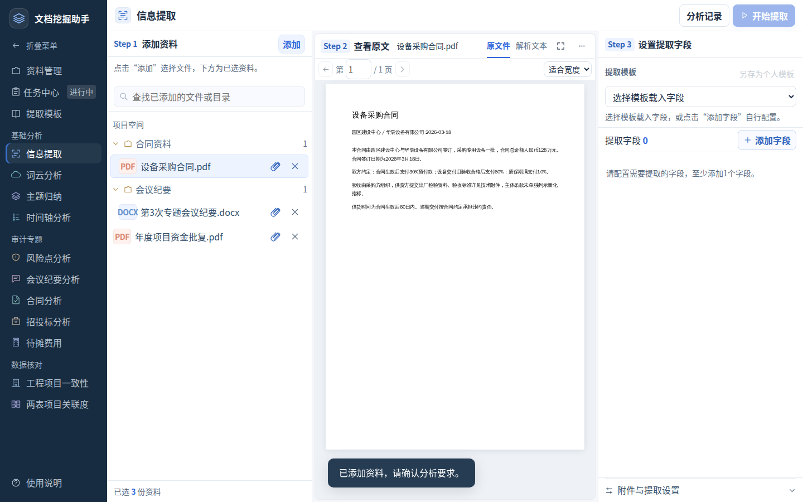
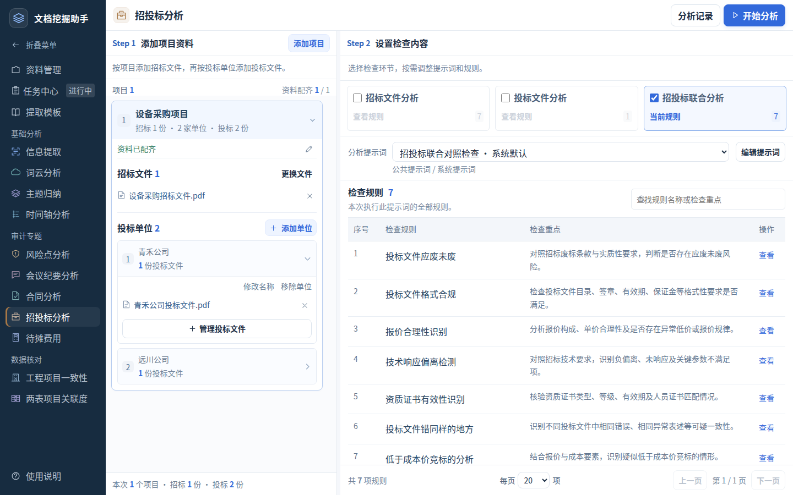
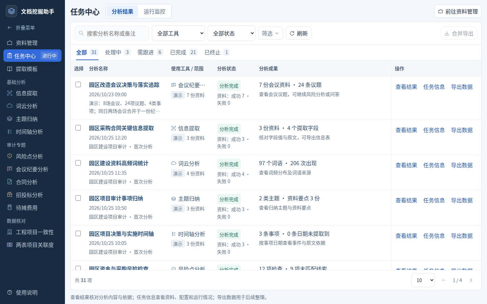

# 证据索引与版本说明

## 1. 审查基线

| 项目 | 值 |
| --- | --- |
| 审查日期 | 2026-10-25 |
| 应用源码基线 | `2e7b0b29450609b156674e413364ee0d150cda74` |
| 静态资源版本 | `20261024.80` |
| 静态树SHA256 | `818f81bc7fbf41ea1aba8e25c09fb64bf09123999050c15ed341e88dd1d7c5bd` |
| 当前交付类型 | 完整设计与研发方案，不是新一轮产品部署 |
| 原源码范围 | `前端代码/`摘录；192文件，78 Vue、86 JS |
| 原型范围 | `优化方案/交互原型/dist/`；248文件，入口加载59脚本与46样式 |

数量用于说明材料范围，不表示每个文件均逐行审计。实际重点为各工具入口、配置、提交构造、结果、任务、权限和预览关键路径。缺失的专用API与服务端行为在04章明确列出。

## 2. 本轮新检查

| 文件 | 检查内容 | 边界 |
| --- | --- | --- |
| [current-review.json](evidence/current-review.json) | 11工具×1440×900、1024×480、390×600共33准备态；公共页面；可用历史结果 | 新浏览器上下文、本地原型；不连真实AI服务 |
| [UI当前版本复核.json](证据/UI当前版本复核.json) | 11工具×1366×768、1024×480、390×600；任务三个无图标操作；辅助字色值 | 仅声明覆盖到的状态，未全量回归所有弹窗和结果 |
| [本轮浏览器检查脚本](evidence/review_current.py) | 留存页面骨架和历史结果快照检查方法 | 使用本机8875端口预览，运行前先启动当前dist |

两份33准备态检查视口有所不同、覆盖重合；不能累加成66个独立功能或66项业务验收通过。新检查未出现脚本错误与页面级横向溢出；UI颜色检查发现3.651–3.825:1辅助文字，已列为整改。

## 3. 既有专项证据

以下文件位于 `优化方案/交互原型/review/`，本轮读取其结论与范围，没有宣称全部重新执行。

| 证据文件 | 支撑结论 |
| --- | --- |
| `large-workloads-checks.json` | 1500份资料的显示分页与执行范围分离，约84万字正文按段显示与全文检索 |
| `picker-range-ime-checks.json`、`selection-range-results.json` | 本页／全部页、跨目录、取消及中文输入 |
| `prompt-guidance-checks.json` | 阶段提示词、个人另存、规则替换、历史只读、无工具设置导入导出 |
| `result-reanalysis-checks.json` | 十一工具再次分析的资料／配置继承、新建记录和旧结果保持 |
| `in-tool-records-checks.json` | 当前工具进度与结果、记录查找、任务去向与执行方式独立 |
| `source-toolbar-checks.json`、`tool-preparation-checks.json` | 原文页头44px与PDF控制行约39px、原件切换、阅读会话和旧隐藏状态恢复 |
| `meeting-timeline-checks.json`、`meeting-filter-checks.json` | 会议时间轴、聚类、议题身份及筛选 |
| `bidding-materials-checks.json` | 命名、项目归组、单招标／多投标、27单位分页 |
| `integrated-evidence-checks.json`、`review-notes-checks.json` | 多来源连续核验、权限变化、独立人工意见 |
| `engineering-workflow-checks.json`、`association-workflow-checks.json` | 字段映射、评分、阈值、动态列、源行与导出 |
| `prepaid-workflow-checks.json` | 提取约定、等待基数、同任务续算与费用报告 |
| `server-deployment-20261024-v3.json` | 上次交付版本的静态资源一致性、页头及标签部署检查 |

这些证据证明的是特定版本、特定夹具和检查范围；正式工程仍须重跑真实服务场景。原型规模与时延不能替代模型吞吐、网络或多用户压力测试。

## 4. 当前界面示例

下图均为本轮当前原型截图，资料及结果用于演示交互。图中数字不表示真实审计业务量。

### 4.1 信息提取准备页

三栏分别承载本次资料、按需查看原文及字段设置；模板初始不选，原文工具栏紧凑。

### 4.2 招投标准备页

项目和单位明确资料归属，规则使用主要空间；文件角色和执行范围不随折叠、分页变化。

### 4.3 会议分析结果

保留会议时间轴与议题聚类的专业阅读方式；结果页不常驻准备态资料清单。

### 4.4 任务中心

查看结果、任务信息、导出数据为直接可见文字操作；按实际工具打开对应成果。

## 5. 需求与方案对应

| 用户关注 | 方案位置 |
| --- | --- |
| 整体review与优化思路 | 01章总体结论、设计原则；05章问题清单 |
| 设计理念与新人可操作性 | 01章业务目标与流程；03章文案、组件和状态 |
| 对标参考 | 06章官方依据、可借鉴点与不照搬内容 |
| 系统提升了什么 | 01章第6节、02章第5节；05章效果测量 |
| 所有工具核心功能不要丢 | 02章十一工具对照；04章载荷与结果映射 |
| UI开发规范 | 03章最终词表、布局、变量、组件、输入、可访问性 |
| 后端需开发调整内容 | 04章R/F/C/E分类、BE-01—BE-11、最小契约与验收 |
| 开发安排和验收 | 01章实施顺序；05章责任、场景和指标 |
| 已完成与待处理界限 | 各章状态声明；05/07章当前与历史证据边界 |

## 6. 文档版本管理

本目录Markdown是内容源；PDF、Word和HTML由同一内容生成。新版覆盖产品口径时保留历史文档作追溯，不把旧截图当新版本验证。

源码行号依本次基线，后续重构后可能移动。后端清单中的函数、路径和业务字段优先作为定位线索；接口事实仍须以真实服务联调确认。外部参考链接访问时间为2026-10-25。
